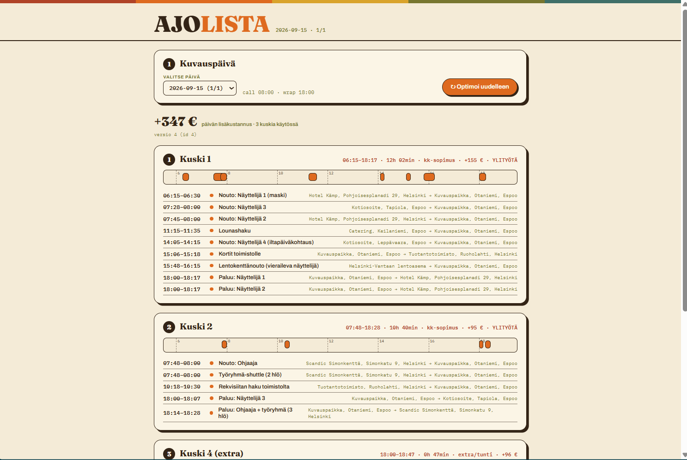
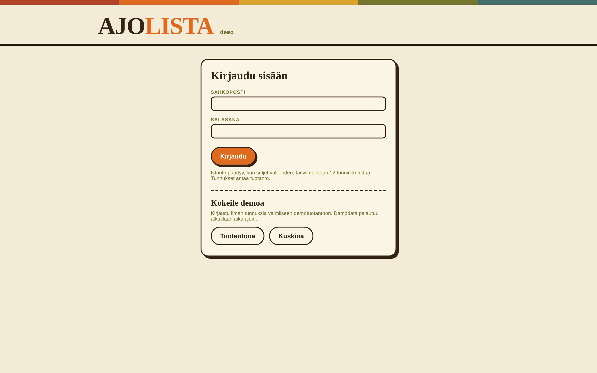
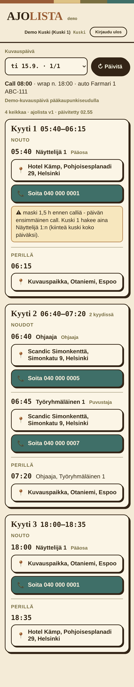
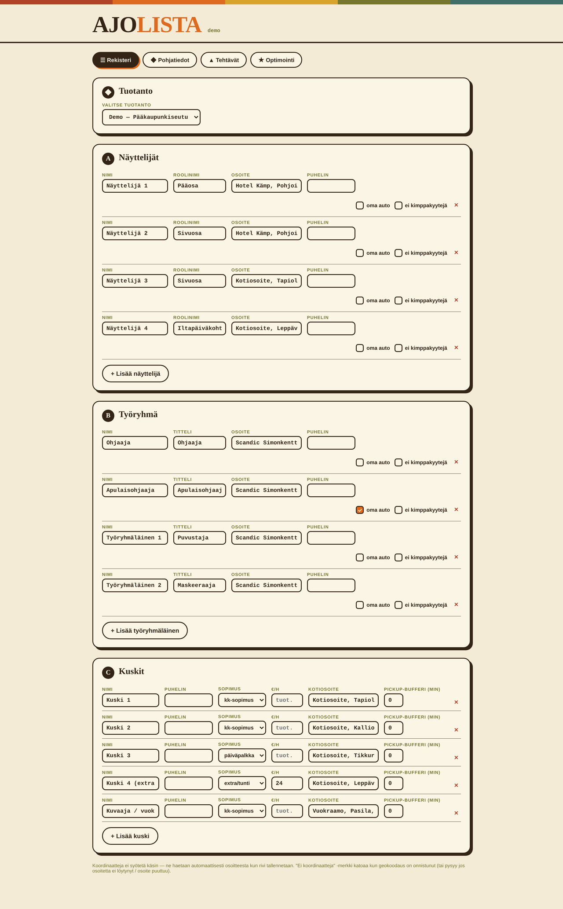

# Ajuri

Ajuri optimoi kuvausryhmän päivittäiset kuljetukset: kuka noudetaan mistä,
kuka ajaa kenetkin, ja paljonko päivä maksaa. Elokuva- ja tv-tuotannoissa
tämä ajolista tehdään yleensä käsin Excelissä ja Google Mapsissa — työ vie
tuotantokoordinaattorilta tunteja, ja suunnitelma joudutaan tekemään
uudestaan useita kertoja päivässä kun joku sairastuu, lento myöhästyy tai
kuvausjärjestys muuttuu. Ajuri tekee saman laskennan sekunneissa ja
tallentaa jokaisen version, jotta muutoksen voi jäljittää.

**Kokeile:** [ajuri.onrender.com](https://ajuri.onrender.com) — valitse
kirjautumissivulta "Kokeile demoa". Demo pyörii Renderin ilmaisella
tasolla, joten ensimmäinen avaus voi kestää noin minuutin, kun palvelin
herää.

**Lue lisää:** [arkkitehtuuri](docs/arkkitehtuuri.md) ·
[optimoijan speksi](docs/optimoija-spec.md) ·
[tuotekartta](docs/tuotekartta.md) · [julkaisu](docs/julkaisu.md) ·
[käynnistysohje](docs/ajuri-kaynnistys.md)



| Kirjautuminen demonapeilla | Kuskin päivä puhelimella | Rekisteri |
|---|---|---|
|  |  |  |

## Miksi tämä on vaikea ongelma

Kyse ei ole pelkästä reitinoptimoinnista, vaan aikataulutetusta
kuljetustehtävästä useilla samanaikaisilla rajoitteilla:

- **Aikaikkunat.** Jokaisella henkilöllä on call time (milloin pitää olla
  paikalla), osalla myös aikaisin nouto- tai viimeisin perilläoloaika
  (esim. lento laskeutuu tiettyyn kellonaikaan). Ketään ei saa jättää
  odottamaan tuntia autoon eikä myöhästyttää settiin.
- **Kapasiteetti.** Auton mukavuuspaikat rajaavat kuinka moni mahtuu
  samaan kyytiin — ja osa henkilöistä ei saa jakaa kyytiä kenenkään
  kanssa (esim. aikataulusyistä tai tuotannollisista syistä).
- **Kuskien sopimustyypit ja ylityöportaat.** Kuukausipalkkaisen kuskin
  käyttö on lähes ilmaista 8 tuntiin asti, päiväpalkkainen maksaa aina
  koko päivän hinnan heti kun häntä käytetään lainkaan, ja
  tuntipalkkaisella extralla on 4 tunnin minimiveloitus. Kaikilla
  ylityöportaat 8–10 h ja yli 10 h eri kertoimin. Halvin ratkaisu ei ole
  aina se, jossa on vähiten kuskeja.
- **Päivänsisäiset siirtymät.** Kuvauspaikka voi vaihtua kesken päivän,
  ja samat autot hoitavat sekä aamun noudot että illan paluukyydit —
  reitit pitää ketjuttaa koko päivän ajalta, ei vain yhtä siirtymää
  kerrallaan.
- **Suunnitelma ei pysy tehtynä.** Kun tilanne muuttuu kesken päivän, jo
  ajetut keikat on lukittava ja loput suunniteltava uusiksi niin, ettei
  pieni muutos myllää koko loppupäivää. Jokainen versio on säilyttävä
  sellaisenaan, jotta jälkikäteen voi tarkistaa minkä listan mukaan
  mentiin.

## Esimerkkitulos

Repossa on seed-skripti (`python -m app.seed`), joka luo yhden
realistisen kuvauspäivän oikeilla pääkaupunkiseudun koordinaateilla: 19
tehtävää (7 henkilön noudot ja paluukyydit, lounashaku, rekvisiitan haku,
lentokenttänouto aikaikkunalla) ja 5 kuskia eri sopimustyypeillä.
Henkilökyydit on merkitty generoiduiksi, joten "Generoi tehtävät" korvaa
ne eikä tuplaa niitä. Näin optimointia ajettiin oikeasti seedin aiemmalla
16 tehtävän versiolla, jossa työryhmän kyydit olivat yhdistettyinä:

| Kuskikokoonpano | Kokonaiskustannus |
|---|---|
| 3 kuskia tarjolla (2× kuukausi + päiväpalkka/minibussi) | 426,07 € |
| 4 kuskia tarjolla (+ tuntipalkkainen extra) | **346,80 €** |
| 5 kuskia tarjolla (+ ilta-ajan kuukausikuski) | **260,33 €** |

Kolme löydöstä, jotka eivät ole itsestään selviä ilman laskentaa:

1. **Neljäs kuski oli halvempi kuin kolmas.** Kun tuntipalkkainen extra
   otettiin mukaan vaihtoehtoihin, optimoija korvasi sillä kalliimman
   päiväpalkkaisen minibussikuskin — enemmän vaihtoehtoja johti
   halvempaan lopputulokseen, ei kalliimpaan.
2. **Tuntipalkkainen extra oli halvempi kuin päiväpalkkainen kuski**
   yhden lyhyen illan keikan hoitamiseen: 4 tunnin minimiveloitus voitti
   päiväpalkkaisen kiinteän 8 tunnin hinnan.
3. **Yksi lisäkuski pudotti hinnan 260 euroon.** Ilta-ajaksi (klo 18
   alkaen) tarjolla oleva kuukausikuski hoiti illan yksinäiskyydin
   nollakustannuksella, koska hänen palkkansa on jo muutenkin maksettu —
   ja korvasi näin tuntipalkkaisen extran kokonaan.

Kaikki 16 tehtävää sijoittuivat joka kokoonpanossa. Halvimmassa
ratkaisussa kaksi kuskia venyi yli 8 tunnin vuoroon (12,15 h ja 10,77 h),
mikä laukaisi ylityölisät — optimoija hyväksyi sen, koska se oli silti
halvempaa kuin lisäkuskin palkkaaminen.

## Tekninen toteutus

| Osa | Teknologiat |
|---|---|
| Backend | Python 3.12+, FastAPI, SQLAlchemy 2.0 (async), Pydantic v2 |
| Tietokanta | PostgreSQL 16, Alembic-migraatiot |
| Optimointi | Google OR-Tools (reitityssolveri), `ProcessPoolExecutor` |
| Kartat | OSRM (ajoajat), Nominatim (geokoodaus), Photon (osoite-ehdotukset) |
| Kirjautuminen | JWT (PyJWT), argon2-salasanat, slowapi-pyyntörajoitukset |
| Frontend | React 19 + Vite, ei UI-kirjastoa |
| Ajo ja julkaisu | Docker Compose, GitHub Actions, Render |

Kerrokset, optimointiputki kaavioineen ja keskeisten ratkaisujen syyt
ovat dokumentissa **[docs/arkkitehtuuri.md](docs/arkkitehtuuri.md)**.

**Hakemistot:**

```
app/
  models.py              SQLAlchemy 2.0 -mallit
  schemas.py             Pydantic v2 -skeemat (Create/Read erikseen)
  rooli.py               Kirjautunut käyttäjä ja rooli tokenista
  omistus.py             Käyttäjä näkee vain oman tuotantonsa datan
  response_filter.py     Roolipohjainen kenttäsuodatus vastauksiin
  routers/               REST-endpointit (CRUD, generointi, optimointi,
                         versiot ja versiodiffi, osoite-ehdotukset)
  services/
    optimoija.py           OR-Tools-malli, syyanalyysi, skenaariot
    laskenta.py            Optimoinnin ajo erillisessä prosessipoolissa
    kustannus.py           Sopimustyyppikohtainen kustannuslaskenta
    matka_cache.py         Ajoaikojen välimuisti
    router_client.py       Reititys-API-abstraktio (OSRM)
    geocoder_client.py     Geokoodaus-API-abstraktio (Nominatim)
    geokoodaus_cache.py    Osoitteiden geokoodausvälimuisti
    osoite_ehdottaja.py    Osoite-ehdotukset kirjoittaessa (Photon)
  seed.py                Demo-kuvauspäivän generointi
alembic/                 Tietokantamigraatiot
tests/                   Pytest-testit
frontend/src/            React-frontti: Rekisteri, Pohjatiedot, Tehtävät,
                         Optimointi (tulos, tulostus, versiodiffi,
                         kuski pois pelistä), kirjautuminen, kuskin
                         päivänäkymä puhelimelle, yhteinen OsoiteKentta
scripts/                 Windowsin käynnistys- ja sammutusskriptit
docs/                    Spesifikaatiot, tuotekartta, käynnistysohjeet
.github/workflows/ci.yml CI: pytest, Docker Compose + migraatiot, frontti
ajolista_optimoija.py    Alkuperäinen OR-Tools-prototyyppi (itsenäinen)
```

### Optimointimalli

Kuljetustehtävät mallinnetaan
pickup-and-delivery-ongelmana aikaikkunoilla (VRPTW) OR-Toolsin
reitityssolverilla. Jokainen tehtävä on nouto- ja jättösolmupari, jotka
on sidottu samaan ajoneuvoon ja oikeaan järjestykseen; kuskit ovat
solmugraafin ajoneuvoja, jotka lähtevät kotoa (tai edellisen version
viimeisestä lukitusta keikasta reoptimoinnissa) ja palaavat sinne.
Kapasiteettirajoite on toteutettu per-ajoneuvo-kysyntäfunktiolla, mikä
mahdollistaa myös "ei kimppakyytiä" -rajoitteen (kysyntä = koko auton
kapasiteetin täyttävä silloin kun kyseistä henkilöä kuljetetaan).
Kustannusmalli ohjaa hakua sopimustyyppikohtaisilla kiinteillä ja
ylityöporrastetuilla kustannuksilla; tarkka euromäärä lasketaan
ratkaisun jälkeen erikseen.

### Keskeiset ratkaisut lyhyesti

Perustelut ja yksityiskohdat: [docs/arkkitehtuuri.md](docs/arkkitehtuuri.md#keskeiset-ratkaisut-ja-niiden-syyt).

- **Bufferit vain aikadimensiossa.** Kuskin ja henkilön noutopuskuri
  lisätään aikaan mutta ei kustannukseen, jottei optimoija välttele
  ihmisiä, joista on kirjattu realistista dataa.
- **Ulkoiset palvelut abstraktion takana ja välimuistissa.** Testit eivät
  koske verkkoon, ja reitityspalvelun vaihto on yksi uusi luokka.
- **Photon ehdotuksiin, Nominatim geokoodaukseen.** Nominatimin
  käyttöehdot kieltävät automaattitäydennyksen.
- **Optimointi omassa prosessissaan.** OR-Tools pitää GIL-lukkoa koko
  ratkaisun ajan, joten säikeessä ajettuna koko API pysähtyi.
  Regressiotesti kaatuu, jos laskenta siirretään takaisin säikeeseen.
- **Versiointi.** Jokainen optimointi on uusi versio, julkaistut saavat
  call sheet -värin (WHITE → BLUE → PINK → YELLOW), ja kahta versiota
  voi verrata ("Näyttelijä 2: nouto 7.40 → 8.10").
- **Soft delete.** Mitään ei poisteta kovaa kautta, koska vanhat
  ajolistat viittaavat riveihin.

## Käynnistys

Windowsilla helpoin tapa on tuplaklikata juuren `Käynnistä AJURI.cmd` (ja sammuttaa `Sammuta AJURI.cmd`). Tarkemmat ohjeet: [docs/ajuri-kaynnistys.md](docs/ajuri-kaynnistys.md).

**Backend (Docker Compose):**

```
cp .env.example .env
docker compose up --build
docker compose exec app alembic upgrade head
docker compose exec app python -m app.seed
```

API: http://localhost:8000, Swagger-UI: http://localhost:8000/docs.
Postgres on mäpätty isäntäkoneen porttiin 5433 (ei 5432), koska koneella
voi olla jo natiivi PostgreSQL-palvelu portissa 5432.

**Backend paikallisesti ilman Dockeria** (vaatii käynnissä olevan
Postgresin, esim. `docker compose up -d db`):

```
python -m venv venv
venv\Scripts\activate
pip install -r requirements.txt
copy .env.example .env
alembic upgrade head
python -m app.seed
uvicorn app.main:app --reload
```

**Frontend:**

```
cd frontend
cp .env.example .env
npm install
npm run dev
```

Avaa http://localhost:5173. Vaatii backendin käynnissä portissa 8000 —
CORS on sallittu porttiin 5173 (`app/config.py: cors_origins`).

Sovellus avautuu kirjautumissivulle. Kirjaudu jollakin alla olevista
demotunnuksista (Kirjautuminen-osio). Istunto pidetään selaimen
`sessionStorage`ssa: sivun päivitys ei kirjaa ulos, mutta välilehden
sulkeminen kirjaa. Kun token vanhenee (12 h), sovellus palaa
kirjautumissivulle viestillä "Istunto vanheni". Kuski ei näe välilehtiä
lainkaan, vaan oman päivänsä (ks. alla).

Frontin välilehdet kulkevat työn järjestyksessä:

- **Rekisteri** — tuotannon henkilöt (näyttelijät, työryhmä) ja kuskit.
  Osoitekenttä ehdottaa osoitteita kirjoittaessa.
- **Pohjatiedot** — kuvauspäivän kokoaminen: call, lounas ja wrap,
  päivän lokaatiot siirtymineen sekä mukana olevat henkilöt ja kuskit autoineen
- **Tehtävät** — "Generoi tehtävät" call timeista, generoitujen ja käsin
  lisättyjen erottelu sekä pikapohjat (lounashaku, kortit, lentokenttä)
- **Optimointi** — optimoi päivä ja katso tulos per kuski aikajanoineen,
  kustannuksineen, sijoittamattomien syineen ja skenaariovertailuineen.
  Lisäksi julkaisu värikoodilla, A4-tulostusversio ilman kustannuksia,
  versiodiffi ("Näyttelijä 2: nouto 7.40 → 8.10") ja "kuski pois pelistä"
  -hätänappi, joka optimoi loppupäivän uudelleen kuitatut keikat
  lukittuina. Päivän viimeisin ajolista näkyy heti, ja kesken oleva
  laskenta jatkuu, vaikka sivun päivittäisi.

**Kuskin päivä** (KUSKI-rooli) on tehty ensisijaisesti puhelimelle. Kuski
näkee julkaistusta ajolistasta vain omat keikkansa aikajärjestyksessä
kyydeiksi ryhmiteltyinä: nouto- ja jättöosoitteet karttalinkkeinä,
kyytiläiset ja heidän puhelinnumeronsa soittonappeina. Karttalinkki avaa
puhelimen karttasovelluksen vasta napautettaessa, sovellus ei itse kutsu
karttapalvelua. Demossa tämän näkee "Kokeile demoa → Kuskina" -napista
(seedin henkilöillä on keksityt 040 000 xxxx -numerot).

### Käyttäjät ja kirjautuminen

Seed luo kolme demokäyttäjää demotuotantoon. Salasanat ovat julkisia,
joten niitä käytetään vain demo- ja kehityskannassa:

| Rooli | Email | Salasana |
|---|---|---|
| Tuotanto | `tuotanto@ajuri.example` | `demo-tuotanto` |
| Koordinaattori | `koordi@ajuri.example` | `demo-koordi` |
| Kuski (Kuski 1) | `kuski@ajuri.example` | `demo-kuski` |

**Demotila.** Kun backendin ympäristömuuttuja `DEMO=true`, kirjautumissivulla
on "Kokeile demoa" -napit (Tuotantona, Kuskina), jotka kirjautuvat yllä
oleviksi demokäyttäjiksi ilman salasanaa (`GET /auth/demo`,
`POST /auth/demo`). Napit näkyvät vain, jos seed on ajettu. Oletus on
`DEMO=false`, jolloin nappeja ei ole ja `POST /auth/demo` vastaa 404.
Renderin demojulkaisussa `DEMO=true` (ks. `docs/julkaisu.md`).


Oikean käyttäjän luonti (salasana kysytään piilotettuna, vähintään 10 merkkiä):

```
python -m app.luo_kayttaja --email tanja@example.com --rooli tuotanto
python -m app.luo_kayttaja --email kuski@example.com --rooli kuski --kuski-id 3
```

`--tuotanto-id` tarvitaan vain, jos kannassa on useampi tuotanto. Uusi
tuotanto luodaan samalla komennolla, koska API ei salli tuotannon luontia
(`POST /tuotannot` → 403):

```
python -m app.luo_kayttaja --uusi-tuotanto "Elokuva X" --email tanja@example.com --rooli tuotanto
```

`POST /auth/kirjaudu` palauttaa 12 tuntia voimassa olevan JWT-tokenin, ja
`GET /auth/mina` kertoo kirjautuneen käyttäjän (`Authorization: Bearer <token>`).

Kaikki muut reitit vaativat tokenin, paitsi `GET /`, `GET /health` ja
kehityksessä dokumentaatio (`/docs`, `/openapi.json`). Ilman voimassa olevaa tokenia
vastaus on 401. KUSKI-rooli saa vain lukea: kaikki muokkaukset (POST, PUT,
PATCH, DELETE) antavat 403. Käyttäjä näkee vain oman tuotantonsa datan;
toisen tuotannon rivit antavat 404 kuten olemattomat.

```
TOKEN=$(curl -s -X POST http://localhost:8000/auth/kirjaudu \
  -H "Content-Type: application/json" \
  -d '{"email":"tuotanto@ajuri.example","salasana":"demo-tuotanto"}' | jq -r .access_token)
curl -H "Authorization: Bearer $TOKEN" http://localhost:8000/henkilot
```

Swaggerissa (`/docs`) token annetaan Authorize-napista.

Tokenin allekirjoitusavain luetaan ympäristömuuttujasta `JWT_SECRET`.
Kehityksessä (`AJURI_YMPARISTO=dev`, oletus) käytetään sisäänrakennettua
kehitysavainta, jos muuttujaa ei ole asetettu. Kun `AJURI_YMPARISTO=prod`,
puuttuva `JWT_SECRET` kaataa käynnistyksen.

### Tuotantoasetukset (`AJURI_YMPARISTO=prod`)

Prodissa sovellus kieltäytyy käynnistymästä ja luettelee kaikki puutteet
kerralla, jos

- `JWT_SECRET` puuttuu, on alle 32 merkkiä tai on kehityksen oletusavain
- `DATABASE_URL`:ssa ei ole salasanaa tai se on kehityksen oletus (`ajuri`)
- `CORS_ORIGINS` sisältää `*`

Lisäksi prodissa

- `/docs`, `/redoc` ja `/openapi.json` ovat pois päältä (`GET /` palauttaa
  `"dokumentaatio": null`)
- CORS sallii vain `CORS_ORIGINS`-muuttujan osoitteet. Ilman muuttujaa
  mitään vierasta osoitetta ei sallita. Muoto on JSON-lista:
  `CORS_ORIGINS=["https://ajuri.example"]`

Kaikissa ympäristöissä odottamaton virhe palauttaa 500-vastauksen yleisellä
viestillä. Traceback ja mahdollinen SQL menevät vain palvelimen lokiin.
Jokaisessa vastauksessa ovat turvaotsakkeet `X-Content-Type-Options: nosniff`,
`Referrer-Policy: no-referrer` ja `X-Frame-Options: DENY`.

### Pyyntörajoitukset

Raja ylittyy → `429` ja `Retry-After`-otsake. Rajat ovat ympäristö-
muuttujia (muoto `5/minute`, `100/hour`):

| Reitti | Oletus | Kenen mukaan | Muuttuja |
|---|---|---|---|
| `POST /auth/kirjaudu` | 5 / min | IP-osoite | `RAJOITUS_KIRJAUTUMINEN` |
| `GET /osoitteet/ehdota` | 60 / min | käyttäjä | `RAJOITUS_OSOITE_EHDOTUKSET` |
| `POST /paivat/{id}/optimoi` | 6 / min | käyttäjä | `RAJOITUS_OPTIMOINTI` |

`RAJOITUKSET_KAYTOSSA=false` kytkee kaikki pois. Laskurit ovat prosessin
muistissa, mikä riittää yhdelle uvicorn-prosessille.

Välityspalvelimen (esim. Render) takana yhteyden osoite on välityspalvelimen,
ei käyttäjän. Silloin `LUOTETUT_VALITYSPALVELIMET=N` lukee käyttäjän IP:n
`X-Forwarded-For`-otsakkeesta N:nneksi oikealta. Vasemmanpuoleisinta arvoa ei
käytetä, koska asiakas voi väärentää sen. Oletus 0 = otsaketta ei lueta.

Yksityiskohtaiset käynnistys- ja vianetsintäohjeet:
[docs/ajuri-kaynnistys.md](docs/ajuri-kaynnistys.md).

### Julkaisu (Render)

`render.yaml` julkaisee backendin, frontin ja tietokannan Renderin ilmaiselle
tasolle. Askeleet, salaisuudet ja ilmaisen tason rajat:
[docs/julkaisu.md](docs/julkaisu.md). `DATABASE_URL` kelpaa myös muodossa
`postgresql://...`, sovellus vaihtaa sen asyncpg-muotoon.

## Testit

```
pytest
```

Yli 400 testiä, ajavat SQLite-muistikannalla (ei vaadi Postgresia).
Ulkoiset palvelut korvataan deterministisillä toteutuksilla, joten
testit eivät kosketa verkkoa.

Painopisteet:

- **Kustannuslogiikka** yksikkötasolla: jokainen sopimustyyppi ja
  ylityöporras erikseen
- **OR-Tools-malli** synteettisillä skenaarioilla: aikaikkunat,
  kapasiteetti, "ei kimppakyytiä", kiinteä kuski, bufferit,
  sijoittamattomien syykoodit
- **Regressiotesti kokonaisella vakiopäivällä** (17 tehtävää, 5 kuskia)
  — tämä vahtii optimoinnin *laatua*, ei vain sitä ettei koodi kaadu
- **Reoptimoinnin reunatapaukset**: lukitun keikan tehtävä tai kuski on
  passivoitu myöhemmin — ei saa kaatua, ja keikan tiedot on silti
  näytettävä oikein
- **Rajapintatestit**: CRUD, tehtävägenerointi, version julkaisu ja
  värikoodaus, versiodiffi, keikan kuittaus, kuski pois pelistä,
  roolisuodatus, geokoodaus ja sen välimuisti, osoite-ehdotukset, soft delete
- **Rinnakkaisuus**: optimointi ei jumita muita pyyntöjä (testi pitää
  GIL:ää kuten OR-Tools ja kaatuu, jos laskenta ajetaan säikeessä), ja
  saman päivän päällekkäinen optimointi estetään

Migraatiot ajetaan ja `alembic check` varmistetaan erikseen oikeaa
PostgreSQL:ää vasten, koska testit luovat taulut suoraan malleista.

**CI (GitHub Actions)** ajaa jokaiselle PR:lle kolme tarkistusta: pytest,
Docker Compose -buildin migraatioineen ja `alembic check`ineen oikeaa
PostgreSQL:ää vasten sekä frontin lintin ja buildin. `main` on suojattu,
joten muutokset kulkevat aina PR:nä ja vihreän CI:n kautta.

## Roolit

API:ssa on kolme roolia (`KayttajaRooli`-enum): TUOTANTO, KOORDI ja KUSKI.
TUOTANTO ja KOORDI näkevät kaiken ja saavat muokata. KUSKI saa vain
lukea, ja siltä piilotetaan
vastauksista kustannuskentät (`ajolista_versio.kokonaiskustannus_eur`,
kuskikohtainen `lisakustannus_eur`, koko skenaariovertailu) sekä
henkilö-/kuskikohtaiset bufferi- ja aikapreferenssikentät
(`henkilo.nouto_bufferi_min`, `henkilo.max_etuajassa_min`,
`kuski.pickup_bufferi_min`, `kuski.tuntihinta_eur`) — nämä eivät katoa
vain `null`:iksi, vaan puuttuvat JSON-vastauksesta kokonaan.

KUSKI näkee lisäksi vain julkaistut ajolistaversiot ja niistä vain omat
keikkansa (käyttäjän `kuski_id`). Luonnos tai vanha versio näyttää
kuskille samalta kuin olematon (404), ja versiodiffissäkin näkyvät vain
omat keikat. Kuskiin linkittämätön kuski-käyttäjä ei näe yhtään keikkaa.
Säännöt ovat `app/omistus.py`:ssä.

Rooli luetaan kirjautumistokenista (`app/rooli.py`). Vanhaa
`X-Rooli`-headeria ei enää lueta. Kenttäsuodatus on yhdessä paikassa,
`app/response_filter.py`.

Myös huomio: **Swagger-dokumentaatio (`/docs`) näyttää aina kaikki
kentät roolista riippumatta** — endpointtien `response_model` on jätetty
paikoilleen dokumentaatiota varten, mutta ajonaikainen suodatus tapahtuu
sen ohi (`JSONResponse` palautetaan suoraan). Swaggerin "Try it out"
-kutsu näyttää silti oikean, suodatetun JSON-vastauksen — vain skeeman
kuvaus (mitä kenttiä VOISI olla) on aina täysi.

## Tilanne ja jatkokehitys

**Valmiina:** perusdatan ja päiväkohtaisen datan CRUD ja niiden
syöttönäkymät, tehtävägenerointi call timeista, optimointi
kustannuslaskentoineen, syyanalyyseineen ja skenaariovertailuineen
omassa prosessissaan, reoptimointi ("kuski pois pelistä"), versiointi,
värikoodaus ja versiodiffi, tulostusversio, osoite-ehdotukset
kirjoittaessa, soft delete kaikelle datalle, palveluaikabufferit,
roolipohjainen kenttäsuodatus ja geokoodaus välimuisteineen.
Lisäksi kirjautuminen (salasanat, JWT, tuotantokohtainen näkyvyys),
kovennukset (prod-asetukset, pyyntörajoitukset, syötteiden rajat,
haavoittuvuusskannaus CI:ssä), demojulkaisu Renderiin sekä kuskin oma
päivänäkymä puhelimelle, jossa kuski näkee vain omat keikkansa.

**Työn alla ja seuraavaksi** ([ROADMAP.md](ROADMAP.md)):

1. **Excel-tuonti rekisteriin** esikatselulla: backend on PR:nä (#39),
   frontin "Tuo Excelistä" -näkymä tulee sen jälkeen
2. **"Kyydissä" / "Perillä" -kuittaukset** kuskin näkymään: vaatii
   tietokantamuutoksen, jonka skeemasta päätetään ensin (#38)

Pidemmän aikavälin suunta ja perustelut ovat tiedostossa
[docs/tuotekartta.md](docs/tuotekartta.md). Optimoijan rajapinta,
kustannusmalli, rajoitteet ja reunatapaukset on speksattu erikseen
tiedostossa [docs/optimoija-spec.md](docs/optimoija-spec.md).
