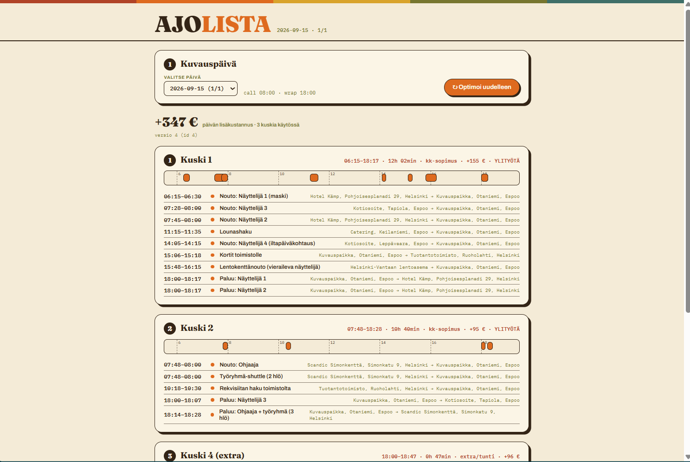

# Ajuri

Ajuri optimoi kuvausryhmän päivittäiset kuljetukset: kuka noudetaan mistä,
kuka ajaa kenetkin, ja paljonko päivä maksaa. Elokuva- ja tv-tuotannoissa
tämä ajolista tehdään yleensä käsin Excelissä ja Google Mapsissa — työ vie
tuotantokoordinaattorilta tunteja, ja suunnitelma joudutaan tekemään
uudestaan useita kertoja päivässä kun joku sairastuu, lento myöhästyy tai
kuvausjärjestys muuttuu. Ajuri tekee saman laskennan sekunneissa ja
tallentaa jokaisen version, jotta muutoksen voi jäljittää.



## Miksi tämä on vaikea ongelma

Kyse ei ole pelkästä reitinoptimoinnista, vaan aikataulutetusta
kuljetustehtävästä useilla samanaikaisilla rajoitteilla:

- **Aikaikkunat.** Jokaisella henkilöllä on call time (milloin pitää olla
  paikalla), osalla myös aikaisin nouto- tai viimeisin perilläoloaika
  (esim. lento laskeutuu tiettyyn kellonaikaan). Ketään ei saa jättää
  odottamaan tuntia autoon eikä myöhästyttää settiin.
- **Kapasiteetti.** Auton mukavuuspaikat rajaavat kuinka moni mahtuu
  samaan kyytiin — ja osa henkilöistä ei saa jakaa kyytiä kenenkään
  kanssa (esim. aikataulusyistä tai tuotannollisista syistä).
- **Kuskien sopimustyypit ja ylityöportaat.** Kuukausipalkkaisen kuskin
  käyttö on lähes ilmaista 8 tuntiin asti, päiväpalkkainen maksaa aina
  koko päivän hinnan heti kun häntä käytetään lainkaan, ja
  tuntipalkkaisella extralla on 4 tunnin minimiveloitus. Kaikilla
  ylityöportaat 8–10 h ja yli 10 h eri kertoimin. Halvin ratkaisu ei ole
  aina se, jossa on vähiten kuskeja.
- **Päivänsisäiset siirtymät.** Kuvauspaikka voi vaihtua kesken päivän,
  ja samat autot hoitavat sekä aamun noudot että illan paluukyydit —
  reitit pitää ketjuttaa koko päivän ajalta, ei vain yhtä siirtymää
  kerrallaan.

## Esimerkkitulos

Repossa on seed-skripti (`python -m app.seed`), joka luo yhden
realistisen kuvauspäivän oikeilla pääkaupunkiseudun koordinaateilla: 16
tehtävää (henkilönoutoja, paluukyytejä, lounashaku, rekvisiitan haku,
lentokenttänouto aikaikkunalla) ja 5 kuskia eri sopimustyypeillä. Näin
optimointia ajettiin oikeasti tällä datalla:

| Kuskikokoonpano | Kokonaiskustannus |
|---|---|
| 3 kuskia tarjolla (2× kuukausi + päiväpalkka/minibussi) | 426,07 € |
| 4 kuskia tarjolla (+ tuntipalkkainen extra) | **346,80 €** |
| 5 kuskia tarjolla (+ ilta-ajan kuukausikuski) | **260,33 €** |

Kolme löydöstä, jotka eivät ole itsestään selviä ilman laskentaa:

1. **Neljäs kuski oli halvempi kuin kolmas.** Kun tuntipalkkainen extra
   otettiin mukaan vaihtoehtoihin, optimoija korvasi sillä kalliimman
   päiväpalkkaisen minibussikuskin — enemmän vaihtoehtoja johti
   halvempaan lopputulokseen, ei kalliimpaan.
2. **Tuntipalkkainen extra oli halvempi kuin päiväpalkkainen kuski**
   yhden lyhyen illan keikan hoitamiseen: 4 tunnin minimiveloitus voitti
   päiväpalkkaisen kiinteän 8 tunnin hinnan.
3. **Yksi lisäkuski pudotti hinnan 260 euroon.** Ilta-ajaksi (klo 18
   alkaen) tarjolla oleva kuukausikuski hoiti illan yksinäiskyydin
   nollakustannuksella, koska hänen palkkansa on jo muutenkin maksettu —
   ja korvasi näin tuntipalkkaisen extran kokonaan.

Kaikki 16 tehtävää sijoittuivat joka kokoonpanossa. Halvimmassa
ratkaisussa kaksi kuskia venyi yli 8 tunnin vuoroon (12,15 h ja 10,77 h),
mikä laukaisi ylityölisät — optimoija hyväksyi sen, koska se oli silti
halvempaa kuin lisäkuskin palkkaaminen.

## Tekninen toteutus

**Stack:** Python 3.13, FastAPI, SQLAlchemy 2.0 (async), PostgreSQL 16,
Alembic, Google OR-Tools, OSRM, React + Vite, Docker Compose.

**Arkkitehtuuri:**

```
app/
  models.py           SQLAlchemy 2.0 -mallit
  routers/            REST-endpointit (CRUD + optimointi)
  services/
    optimoija.py         OR-Tools-malli
    kustannus.py          Sopimustyyppikohtainen kustannuslaskenta
    matka_cache.py         Ajoaikojen välimuisti
    router_client.py       Reititys-API-abstraktio (OSRM)
  seed.py             Demo-kuvauspäivän generointi
alembic/              Tietokantamigraatiot
tests/                Pytest-testit (25 kpl)
frontend/             Vite + React -demofrontti
docs/                 Spesifikaatiot ja tuotekartta
```

**Optimointimalli:** kuljetustehtävät mallinnetaan
pickup-and-delivery-ongelmana aikaikkunoilla (VRPTW) OR-Toolsin
reitityssolverilla. Jokainen tehtävä on nouto- ja jättösolmupari, jotka
on sidottu samaan ajoneuvoon ja oikeaan järjestykseen; kuskit ovat
solmugraafin ajoneuvoja, jotka lähtevät kotoa (tai edellisen version
viimeisestä lukitusta keikasta reoptimoinnissa) ja palaavat sinne.
Kapasiteettirajoite on toteutettu per-ajoneuvo-kysyntäfunktiolla, mikä
mahdollistaa myös "ei kimppakyytiä" -rajoitteen (kysyntä = koko auton
kapasiteetti täyttävä silloin kun kyseistä henkilöä kuljetetaan).
Kustannusmalli ohjaa hakua sopimustyyppikohtaisilla kiinteillä ja
ylityöporrastetuilla kustannuksilla; tarkka euromäärä lasketaan
ratkaisun jälkeen erikseen. Reititys-API:sta (OSRM) haetut ajoajat ja
-matkat välimuistetaan tietokantaan pistepareittain, jotta samoja
osoitteita ei kysytä uudestaan.

## Käynnistys

**Backend (Docker Compose):**

```
cp .env.example .env
docker compose up --build
docker compose exec app alembic upgrade head
docker compose exec app python -m app.seed
```

API: http://localhost:8000, Swagger-UI: http://localhost:8000/docs.
Postgres on mäpätty isäntäkoneen porttiin 5433 (ei 5432), koska koneella
voi olla jo natiivi PostgreSQL-palvelu portissa 5432.

**Backend paikallisesti ilman Dockeria** (vaatii käynnissä olevan
Postgresin, esim. `docker compose up -d db`):

```
python -m venv venv
venv\Scripts\activate
pip install -r requirements.txt
copy .env.example .env
alembic upgrade head
python -m app.seed
uvicorn app.main:app --reload
```

**Frontend-demo:**

```
cd frontend
cp .env.example .env
npm install
npm run dev
```

Avaa http://localhost:5173. Vaatii backendin käynnissä portissa 8000 —
CORS on sallittu porttiin 5173 (`app/config.py: cors_origins`).

## Testit

```
pytest
```

25 testiä, ajavat SQLite-muistikannalla (ei vaadi Postgresia):

- kustannuskaava jokaiselle sopimustyypille ja ylityöportaille (9)
- OR-Tools-malli synteettisillä skenaarioilla, mukaan lukien
  "ei kimppakyytiä" - ja kiinteä kuski -rajoitteet (6)
- regressiotesti alkuperäisellä 17 tehtävän / 5 kuskin
  prototyyppidatalla, joka vahtii optimoinnin laatua eikä vain muotoa (1)
- REST-endpointtien testit: optimointi, päiväkohtainen CRUD,
  version julkaisu ja keikan kuittaus (8)
- savutesti perusdatan CRUD-ketjulle (1)

## Tilanne ja jatkokehitys

Valmiina: perusdatan ja päiväkohtaisen datan CRUD, optimointiservice
kustannuslaskentoineen ja reoptimoinnilla, demo-frontti. Seuraavat
vaiheet (tehtävägenerointi, bufferit, muokattava käyttöliittymä,
geokoodaus, kuskin mobiilinäkymä) on kuvattu järjestyksessä ja
perusteluineen tiedostossa [docs/tuotekartta.md](docs/tuotekartta.md).
