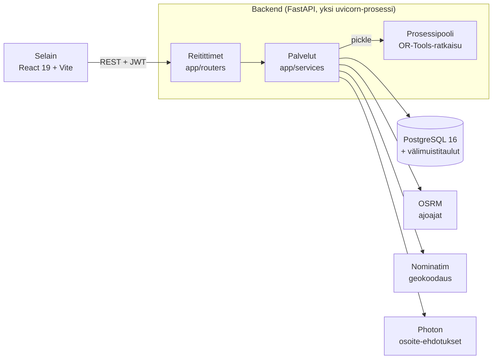
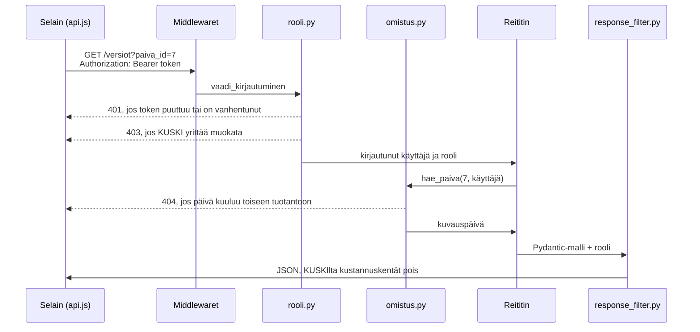
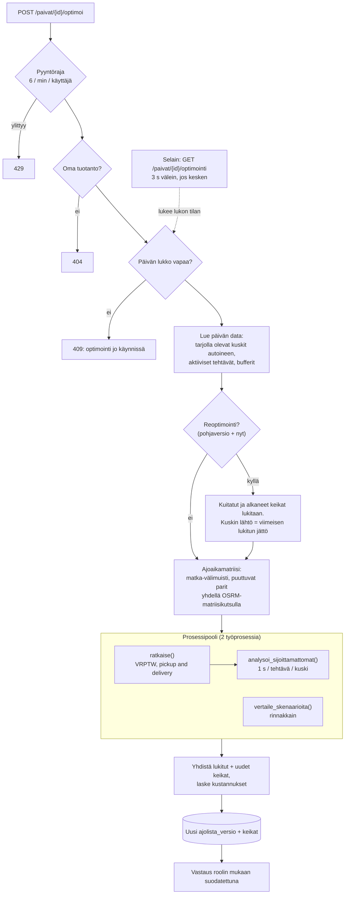
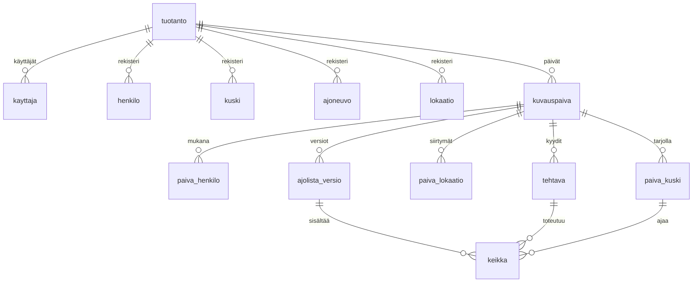

# AJURI — arkkitehtuuri

Tämä dokumentti kertoo, miten AJURI on rakennettu ja miksi juuri näin.
Käyttäjän näkökulma ja käynnistys ovat [README:ssä](../README.md),
optimoijan tarkka sopimus ja kustannusmalli
[optimoija-spec.md:ssä](optimoija-spec.md) ja tuotteen suunta
[tuotekartta.md:ssä](tuotekartta.md).

- [Yleiskuva](#yleiskuva)
- [Kerrokset](#kerrokset)
- [Pyynnön kulku](#pyynnön-kulku)
- [Optimointiputki](#optimointiputki)
- [Tietomalli](#tietomalli)
- [Keskeiset ratkaisut ja niiden syyt](#keskeiset-ratkaisut-ja-niiden-syyt)
- [Tunnetut rajat](#tunnetut-rajat)

## Yleiskuva

Backend on yksi FastAPI-sovellus, joka puhuu tietokannalle async
SQLAlchemyllä. Raskas laskenta (OR-Tools) ajetaan erillisissä
työprosesseissa. Kolme ulkoista palvelua ovat kukin oman rajapintansa
takana, ja kahden niistä tulokset tallentuvat tietokantaan
välimuistiksi.

## Kerrokset

| Kerros | Missä | Vastuu |
|---|---|---|
| Käyttöliittymä | `frontend/src/` | Välilehdet Rekisteri → Pohjatiedot → Tehtävät → Optimointi. Kaikki HTTP-kutsut kulkevat `api.js`:n kautta, joka lisää tokenin ja ohjaa 401:n kirjautumissivulle. Tyylit `ui.jsx`:n apureilla, ei UI-kirjastoa. |
| Sovelluksen kokoonpano | `app/main.py`, `app/config.py` | Middlewaret (CORS, turvaotsakkeet), virheenkäsittelijät (503 tietokantakatkoon, 500 ilman tracebackia), reitittimien liittäminen kirjautumisvaatimuksen kanssa. Asetukset ympäristömuuttujista, prodissa fail-fast. |
| Pääsynhallinta | `app/auth.py`, `app/rooli.py`, `app/omistus.py`, `app/rajoitukset.py` | JWT ja salasanat, rooli tokenista, "käyttäjä näkee vain oman tuotantonsa", pyyntörajoitukset. |
| Reitittimet | `app/routers/` | Yksi tiedosto per resurssi. Ohuita: validointi, omistustarkistus, palvelukutsu, vastaus. |
| Skeemat | `app/schemas.py` | Pydantic v2. Create- ja Read-mallit erikseen, kenttien pituus- ja arvorajat. |
| Vastausten suodatus | `app/response_filter.py` | Kentät, joita KUSKI-rooli ei näe. Yksi lista koko API:lle. |
| Palvelut | `app/services/` | Optimoija, kustannuslaskenta, prosessipooli, välimuistit ja ulkoisten palvelujen asiakkaat. Eivät tiedä HTTP:stä mitään. |
| Tietomalli | `app/models.py`, `alembic/` | SQLAlchemy 2 -mallit ja migraatiot. Testit luovat taulut suoraan malleista, CI varmistaa migraatiot oikeaa PostgreSQL:ää vasten (`alembic check`). |

Optimoijan ydin (`app/services/optimoija.py`) ottaa sisään pelkkiä
dataclasseja ja ajoaikamatriisin, ei tietokantaobjekteja. Siksi sen voi
testata synteettisillä skenaarioilla ilman kantaa ja ajaa toisessa
prosessissa, ja reititin hoitaa tietokannan ja muunnokset.

## Pyynnön kulku

- **Token** (HS256, 12 h) sisältää käyttäjä-id:n, roolin ja tuotanto-id:n.
  Käyttäjä haetaan silti kannasta joka pyynnöllä, jotta passivoitu
  käyttäjä ei pääse sisään vanhalla tokenilla.
- **Toisen tuotannon rivi** näyttää samalta kuin olematon (404 samalla
  viestillä). Vastauksesta ei voi päätellä, onko id:llä jotain toisessa
  tuotannossa.
- **Kenttäsuodatus** tapahtuu vasta vastausta muodostettaessa, joten
  reitittimet käsittelevät aina täyttä dataa. Piilotetut kentät puuttuvat
  JSONista kokonaan eivätkä näy `null`-arvoina.

## Optimointiputki

`POST /paivat/{id}/optimoi` (`app/routers/optimointi.py`) on sovelluksen
raskain reitti. Laskenta kestää noin minuutin skenaariovertailun kanssa.

Vaiheet tarkemmin:

1. **Esitarkistukset.** Pyyntöraja, omistus ja päiväkohtainen
   `asyncio.Lock`. Omistus tarkistetaan ennen lukkoa, jotta toisen
   tuotannon päivästä tulee 404 eikä 409. Toinen optimointi samalle
   päivälle saa heti 409:n eikä jää jonoon, koska jonossa odottava
   pyyntö loisi kilpailevan version.
2. **Data.** Vain tarjolla olevat aktiiviset kuskit ja aktiiviset
   tehtävät. Puuttuva auto tai koordinaatti → 422 selkeällä viestillä
   ennen kuin laskentaa aloitetaan.
3. **Reoptimointi** ("kuski pois pelistä"). Kuitatut ja jo alkaneet
   keikat lukitaan pohjaversiosta sellaisinaan, ja muut suunnitellaan
   uudelleen. Lukitun keikan tehtävä tai kuski on voitu passivoida sen
   jälkeen. Ne haetaan silti näyttöä varten, mutta ratkaisija ei saa
   niitä.
4. **Ajoaikamatriisi.** Pisteet pyöristetään neljään desimaaliin
   (~10 m), haetaan ensin `matka`-taulusta ja puuttuvat parit yhdellä
   matriisikutsulla reitittimeltä. Samat hotellit ja lokaatiot toistuvat
   päivästä toiseen, joten OSRM:ää kutsutaan harvoin.
5. **Ratkaisu prosessipoolissa.** Pääratkaisu ja skenaariovertailu
   ajetaan rinnakkain, syyanalyysi pääratkaisun jälkeen. Syyanalyysi
   kysyy jokaiselle sijoittamattomalle tehtävälle "ehtisikö tämä kuski
   edes yksinään?" ja antaa siitä syykoodin.
6. **Tallennus.** Tulos on aina uusi `ajolista_versio`. Vanhaa versiota
   ei muuteta.
7. **Selain** kyselee `GET /paivat/{id}/optimointi` -tilaa 3 sekunnin
   välein, jos laskenta on kesken. Sivun päivitys kesken laskennan ei
   siis hukkaa tulosta.

Optimointimalli itsessään (solmut, aikadimensio, kapasiteetti, "ei
kimppakyytiä", kustannukset) on kuvattu
[README:n optimointimallissa](../README.md#optimointimalli) ja
[optimoija-spec.md:ssä](optimoija-spec.md).

## Tietomalli

Erilliset välimuistitaulut `matka` (ajoaika ja matka pistepareittain) ja
`geokoodi` (osoite → koordinaatit) eivät viittaa muihin tauluihin.

Rekisteri (henkilöt, kuskit, autot, lokaatiot) on tuotantokohtainen ja
pysyy samana koko tuotannon ajan. Kuvauspäivä kokoaa siitä päivän
osallistujat, ja vasta päivän tasolla valitaan kuskille auto ja
tarjolla oloaika. Tehtävät generoidaan päivän henkilöiden call
timeista, ja käsin voi lisätä erikoiskeikkoja.

## Keskeiset ratkaisut ja niiden syyt

### Ulkoiset palvelut abstraktion takana

`RouterClient`, `GeocoderClient` ja `OsoiteEhdottaja` ovat abstrakteja
rajapintoja, ja reitittimet saavat toteutuksen FastAPIn
dependencynä.

- **Testit eivät koske verkkoon.** Testit korvaavat dependencyt
  deterministisillä toteutuksilla (`FakeGeocoder` ja muut). Koko
  testisarja (yli 400 testiä) ajautuu muutamassa minuutissa ilman
  Dockeria.
- **Palvelun vaihto on pieni muutos.** Julkinen OSRM-demopalvelin ei sovi
  tuotantoon (ei SLA:ta, rate limit). Oma instanssi tai kaupallinen
  palvelu on yksi uusi luokka ja asetusmuutos.
- **Välimuisti on palvelun ulkopuolella** (`matka_cache.py`,
  `geokoodaus_cache.py`), joten se toimii kaikille toteutuksille.
  Geokoodauksessa myös "ei löytynyt" tallennetaan (vanhenee), mutta
  verkkovirhettä ei, koska se voi olla tilapäinen.

### Optimointi prosessipoolissa, ei säikeessä

OR-Toolsin C++-ratkaisija pitää Pythonin GIL-lukkoa koko ratkaisun ajan
ja kutsuu lisäksi jatkuvasti Python-callbackeja. Samassa prosessissa
ajettuna koko API pysähtyi optimoinnin ajaksi: kevytkin `GET` kesti yli
20 sekuntia. Säie ei auttanut juuri GIL:n takia.

Ratkaisu on `ProcessPoolExecutor` (`app/services/laskenta.py`), jossa on
kaksi työprosessia. Pooli luodaan laiskasti ensimmäisellä optimoinnilla
ja suljetaan sovelluksen sammuessa. Jos työprosessi kaatuu, pooli
luodaan uudelleen ja ajo yritetään kerran. Optimoijan funktiot ja niiden
argumentit ovat moduulitason funktioita ja dataclasseja, jotta ne
kulkevat picklellä prosessien välillä.

Vika löytyi toistamalla Windowsin `spawn`-käynnistys ja katsomalla
jumittunutta prosessia py-spyllä. Regressiotesti (`tests/test_laskenta.py`)
pitää GIL:ää kuten OR-Tools ja kaatuu, jos laskenta siirretään takaisin
säikeeseen.

### Versiointi: mitään ei kirjoiteta vanhan päälle

Jokainen optimointi on uusi `ajolista_versio` keikkoineen. Tähän on
kaksi syytä:

- **Jäljitettävyys.** Jälkikäteen pitää voida tarkistaa, minkä listan
  mukaan ajettiin, kun jokin meni pieleen.
- **Reoptimointi tarvitsee pohjan.** "Kuski pois pelistä" lukitsee
  pohjaversiosta kuitatut keikat ja suunnittelee loput.

Julkaistu versio saa alan call sheet -käytännön mukaisen värin (WHITE →
BLUE → PINK → YELLOW, sitten "2. WHITE" ja niin edelleen). Kerrallaan
yksi versio per päivä on julkaistu. Versiodiffi
(`GET /versiot/{a}/diff/{b}`) vertaa kahta versiota tehtävittäin, esim.
"Näyttelijä 2: nouto 7.40 → 8.10".

### Soft delete kaikelle

Henkilöitä, kuskeja, lokaatioita ja tehtäviä ei poisteta kovaa kautta,
koska vanhojen versioiden keikat viittaavat niihin. `DELETE` asettaa
`aktiivinen = false`. Rivi katoaa listauksista ja optimoinnista, mutta
vanha ajolista pysyy ehjänä ja näyttää yhä oikeat nimet. Poistodialogi
kertoo etukäteen, missä riviä on käytetty.

Tämä näkyy myös optimointiputkessa: reoptimoinnissa lukitun keikan
kuski tai tehtävä voi olla passivoitu, ja ne haetaan erikseen näyttöä
varten (ks. vaihe 3 yllä).

### Photon ehdotuksiin, Nominatim geokoodaukseen

Molemmat käyttävät samaa OpenStreetMap-dataa, mutta käyttöehdot
eroavat:

- **Nominatimin** käyttöehdot kieltävät automaattitäydennyksen ja
  rajaavat kutsut yhteen sekunnissa yksilöivällä User-Agentilla.
  AJURI käyttää sitä vain tallennetun osoitteen muuntamiseen
  koordinaateiksi, kun koordinaatteja ei vielä ole, ja tulokset
  välimuistitetaan.
- **Photon** on tehty kirjoittaessa haettaviin ehdotuksiin. Valitun
  ehdotuksen koordinaatit tallentuvat suoraan, joten geokoodausta ei
  tarvita lainkaan. AJURI rajaa ehdotukset 60 pyyntöön minuutissa
  käyttäjää kohden reilun käytön periaatteen mukaan.

Tulokset painotetaan pääkaupunkiseudulle mutta niitä ei rajata, koska
yhteistuotannoissa tarvitaan myös ulkomaisia osoitteita.

### Bufferit vain aikadimensiossa

Kuskilla ja henkilöllä voi olla oma puskuriaika noudolle. Se lisätään
OR-Toolsin aikadimensioon mutta ei kaarikustannukseen. Muuten
optimoija alkaisi välttää kuskia tai henkilöä vain siksi, että hänestä
on kirjattu realistista dataa.

### Roolinäkyvyys yhdessä paikassa

Kaikki kentät, joita KUSKI-rooli ei näe, ovat yhdessä tiedostossa
(`app/response_filter.py`). Uuden reitin tekijän ei tarvitse muistaa
piilottaa kustannuksia itse, ja yhden listan voi auditoida kerralla.
Swagger näyttää aina täyden skeeman, mutta vastaus on silti suodatettu.

### Turvallinen oletus prodissa

`AJURI_YMPARISTO=prod` kieltäytyy käynnistymästä, jos `JWT_SECRET`
puuttuu tai on heikko, tietokannan salasana on kehityksen oletus tai
CORS sallii kaiken. Kaikki puutteet luetellaan kerralla. Prodissa
`/docs` on pois päältä, eikä virhevastauksissa ole tracebackeja eikä
SQL:ää. Selain pitää tokenin `sessionStorage`ssa, jolloin välilehden
sulkeminen kirjaa ulos.

## Tunnetut rajat

Nämä ovat tietoisia valintoja demomittakaavaan. Ne pitää ratkaista
ennen kuin sovellusta ajetaan useammalla prosessilla tai palvelimella.

- **Yksi uvicorn-prosessi.** Päiväkohtainen optimointilukko,
  pyyntörajoitusten laskurit ja Nominatimin 1 kutsu/s -rajoitin ovat
  prosessin muistissa. Usealla workerilla ne pitäisi siirtää jaettuun
  säilöön (esim. Redis tai tietokantalukko).
- **Optimointi on synkroninen pyyntö.** Selain odottaa vastausta noin
  minuutin, ja tilakysely paikkaa sivun päivityksen. Oikea taustajono
  on tuotekartan V2-listalla.
- **Julkiset OSRM- ja Photon-palvelimet** kelpaavat demoon mutta eivät
  tuotantoon. Rajat on kirjattu [julkaisu.md:hen](julkaisu.md).
